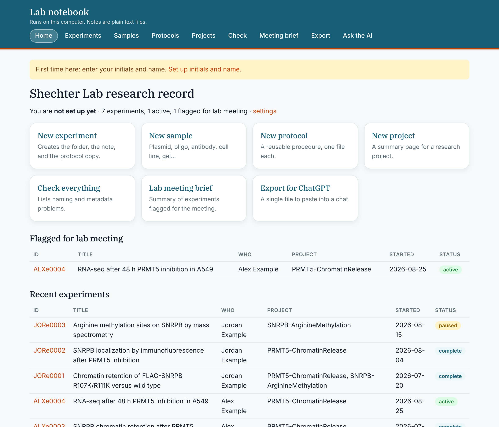
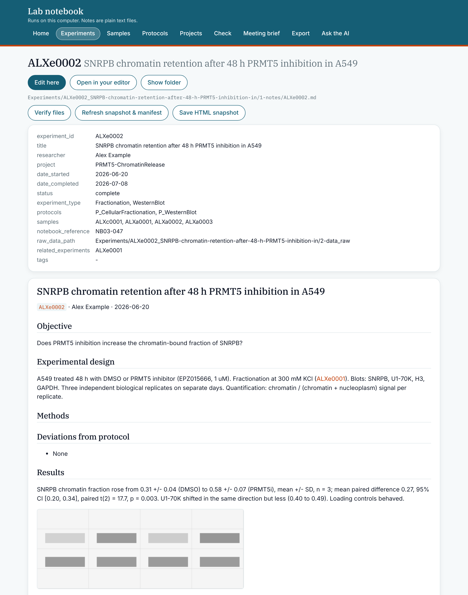

# AI_ELN: the Shechter Lab research record

A lab notebook made of plain files in plain folders. Every experiment gets a
stable ID, the same five subfolders, and one Markdown note with a short
header. Because the structure never varies, a person can find anything in
seconds, a spreadsheet can index it, and an AI assistant can read it and
cite the exact experiment a claim came from.

It needs no accounts, plugins, database, or API keys. In Chrome or Edge it
needs no installation: a page in the browser works directly on the folder.
The same tools also exist as Python scripts with double-click launchers,
and as an MCP server for AI clients.

Website: <https://shechterlab.github.io/AI_ELN/> (served from [`docs/`](docs/README.md)).

## Daily use

1. **Open the notebook.** In Chrome or Edge, go to
   <https://shechterlab.github.io/AI_ELN/app/>, click **Open notebook
   folder**, and choose the folder. Nothing is installed and nothing is
   uploaded. In Safari or Firefox, double-click `launchers/Open ELN`
   instead (needs Python).
2. **Click New experiment, type a title, click Create.** The folder, the
   note, the protocol snapshot, and the inventory row are made for you.
3. **Click Edit here and write.** Objective before you start; Results,
   Interpretation, Decision when you have them.
4. **Drop files into the subfolders**, named with the experiment ID in
   front: `JSRe0002_R_blot-quantification.png` into `5-figures/`. Raw
   instrument files go into `2-data_raw/` untouched. **Show folder** opens it.

When the experiment is done, **Mark complete**
checks it is written up, dates it, and drops a one-file HTML snapshot and
a checksum list next to the note. **Check** tells you if anything is
misnamed or missing; **Meeting brief** writes the summary for the next lab
meeting from whatever you flagged. **Print / save as PDF** prints a note
with page numbers and signature lines, **Repeat this experiment** starts the
next run from the last one, **Adopt** takes in an older folder as an
experiment without changing its files, and **View a notebook** opens
someone's notebook without being able to change it. Practice first on fictional data with
`launchers/Try the Sandbox`.



There are two versions of the page, and they write the same files (the
launcher page has the core jobs; adopting, adding files, printing, and the
folder export are in the browser page and the command line): one runs in the browser ([`docs/app/`](docs/app/README.md),
JavaScript), one is started by a launcher (`scripts/eln_web.py`, Python).
Tests compare their output byte for byte. Terminal-window launchers (`New
Experiment`, `Check Everything`, ...) and a command line do the same
things for people who prefer them. Mac users right-click → Open a launcher
the first time; Windows needs Python installed once. See
[`docs/getting-started.md`](docs/getting-started.md).

## Using it in another lab

Edit [`docs/lab.yaml`](docs/lab.yaml): lab name, institution, links,
colours, fonts, and whether printouts carry signature lines. Replace the
logo in `docs/assets/`. The website, the notebook page, snapshots,
printouts, and exports all read that file; nothing else needs editing. A
notebook folder can carry its own `lab.yaml`, which wins over this one.
The layering follows `configs/lab.yaml` in the lab's pipelines repository.

## Where it lives

A notebook is **one folder per person**. Keep it where you already keep
your work: your Dropbox or OneDrive, a lab share, or a drive. It holds
`notebook.md`, `Experiments/`, `Protocols/`, `Samples/`, `Projects/`, and
`Inventory/`. Every file in it is plain text (Markdown with a small header,
CSV) or an ordinary data file, and the notes are complete and readable in
any editor without the tools. There is no server, no database, and no
central list of people or notebooks.

The tools are separate from the notebook. The browser page works on
whichever folder you open. The Python tools work on the folder you name
once with `eln.py init --root`, or on this folder itself if you name none.

- **Several people.** Each person keeps their own folder. If the folders
  sit next to each other in a shared folder, the page lists them when
  someone opens the shared folder, and **View a notebook** opens any of them
  read-only. IDs start with the owner's initials, so records from different
  notebooks never share an ID.
- **Old folders.** A notebook can be started in a folder that already holds
  work; nothing there is changed. **Adopt** turns an older folder into an
  experiment record when you want it to be one: it gets an ID and a note,
  and the folder is moved, exactly as it is, into the experiment's
  `2-data_raw/`.
- **Exports.** **Export** writes one Markdown file to paste into an AI chat,
  or a folder of plain files: the notes, their data files, a README, and an
  index, laid out like the notebook. For a hosted ELN there is also the
  standard [`.eln`](https://github.com/TheELNConsortium/TheELNFileFormat)
  archive (an RO-Crate ZIP) that eLabFTW, RSpace, Kadi4Mat, PASTA, SampleDB,
  OpenSemanticLab, and SciLog import.

A sync conflict produces two readable copies, and **Check** lists them.
This GitHub repository is only where the tools are developed; nobody needs
it day to day.

## Layout

```
Experiments/
└── JSRe0002_SNRPB-chromatin-retention-KCl-titration/
    ├── 1-notes/            JSRe0002.md  +  JSRe0002_P_WesternBlot_20260901.md (protocol as run)
    ├── 2-data_raw/         instrument output, never renamed, never edited
    ├── 3-code/             JSRe0002_analysis.R
    ├── 4-data_processed/   JSRe0002_quantification.csv
    └── 5-figures/          JSRe0002_R_fractionation-KCl_20260904.png   <- the one you show in lab meeting
Protocols/    P_WesternBlot.md          one living file per protocol
Samples/      JSRp0001.md               plasmids, oligos, antibodies, cell lines, gels...
Projects/     PRMT5-ChromatinRelease.md rolled-up state of a research thread, citing experiment IDs
Inventory/    *.csv                     generated index of all of the above; open in Excel
Exports/      export_.../               folders written by Export; copies, safe to delete
notebook.md                             whose notebook this is, and the last ID given out for each kind of record
```

| Thing | ID looks like | Made by |
|---|---|---|
| Experiment | `JSRe0002` | New experiment |
| Sample | `JSRp0001` (p plasmid, i oligo, a antibody, c cell line, g gel, ...) | New sample |
| Protocol | `P_WesternBlot` | New protocol |
| Project | `PRMT5-ChromatinRelease` | New project |

The initials are yours, so your IDs never collide with anyone else's, in your folder or theirs. An
ID written anywhere is a link. The complete rules fit on one page:
[`docs/CONVENTIONS.md`](docs/CONVENTIONS.md). The one-page version to pin
above your bench: [`docs/CHEATSHEET.md`](docs/CHEATSHEET.md).

Every note starts with a header like this, which is what makes the record
searchable and what the AI reads first:

```yaml
---
type: experiment
experiment_id: JSRe0002
title: SNRPB chromatin retention after PRMT5 inhibition
researcher: Jacob Roth
project: [PRMT5-ChromatinRelease]
date_started: 2026-09-01
status: active            # active | complete | paused | abandoned
protocols: [P_WesternBlot]
samples: [JSRp0001, JSRa0003]
tags: [meeting]           # flag for the next lab meeting
---
```



## Using AI with it

Everything here works with the ChatGPT site license or a Claude
subscription. Nothing needs an API key.

- **ChatGPT, copy and paste.** Click **Export**, pick a project (or all
  active experiments), click **Copy all**, paste into a chat. The export
  contains the notes, everything they reference, and a short primer on
  how to read them. Ask: *summarize what we know, citing experiment IDs*;
  *draft a results paragraph for JSRe0002*; *which experiments used
  JSRa0003?* Once, paste [`docs/ai-briefing.md`](docs/ai-briefing.md) as
  the instructions of a ChatGPT Project so every chat already knows the rules.
- **MCP.** `node mcp/server.mjs` offers the notebook's operations (create,
  find, read, check, complete, export) as tools to any MCP client. Claude
  Code and Cowork pick it up from `.mcp.json` when opened in this (the tools) folder.
  See [`mcp/README.md`](mcp/README.md).
- **Codex, Claude Code, Cowork, Gemini CLI.** Open the tool inside this
  folder (the tools folder). It works on the notebook you named with
  `init --root`. A notebook folder itself holds only a short `AGENTS.md`
  with the rules, not the skills. Here it reads [`AGENTS.md`](AGENTS.md) (the lab's rules: cite IDs,
  never invent a result, create experiments only through the tool) and the
  skills in [`.agents/skills/`](.agents/skills/README.md): how to record an
  experiment, how to search and cite, how to synthesize a project page,
  plus fifteen vendored methodology skills from
  [K-Dense](https://github.com/K-Dense-AI/scientific-agent-skills)
  (statistics, experimental design, figures, EDA, writing, critical
  appraisal, literature search, slides, mass spec, RNA-seq, pathways,
  LabArchives, pre-registration, verification), pinned to a release and
  updated only by a reviewed diff.

[`sandbox/PILOT.md`](sandbox/PILOT.md) shows what those skills produced
when run against the fictional sandbox. Details and reasoning:
[`docs/ai-agents.md`](docs/ai-agents.md).

## Checking the record

**Check** (or `python3 scripts/eln.py validate`) reads every note and
folder and reports what breaks the conventions: a misnamed folder, a
missing subfolder, a `status` that isn't one of the four, a sample ID that
points at nothing, a figure without the experiment ID in front. Errors
fail; warnings are advice. It also spots sync-conflict copies. Run it
before lab meeting and before handing a folder to anyone. Every change to
the tools is tested on macOS, Windows, and Linux, including a strict check
of the sandbox record.

## Command line

Everything the page does is one script with no dependencies:

```bash
python3 scripts/eln.py init                                  # once: initials, name, where files live
python3 scripts/eln.py new experiment --title "..." --project PRMT5-ChromatinRelease --protocol P_WesternBlot
python3 scripts/eln.py new sample --type plasmid --title "pcDNA3-FLAG-SNRPB"
python3 scripts/eln.py validate --strict
python3 scripts/eln.py find --status active --tag meeting
python3 scripts/eln.py index                                 # regenerate Inventory/*.csv
python3 scripts/eln.py report                                # Markdown brief for lab meeting
python3 scripts/eln.py export --project PRMT5-ChromatinRelease --out brief.md
python3 scripts/eln.py export --project PRMT5-ChromatinRelease --format eln --out prmt5.eln   # for eLabFTW/RSpace/...
python3 scripts/eln.py complete JSRe0002                    # close out: snapshot + manifest
python3 scripts/eln.py verify                               # anything changed since completion?
python3 scripts/eln_web.py                                   # the page, by hand
```

The same operations from Node, as JSON: `node mcp/call.mjs --list`.

`--help` on any command. The commands work on the notebook folder named
with `init --root` (or `--root` on one command); with neither, on the folder
the tools sit in.
Tests: `python3 -m unittest discover -s tests` (the JavaScript tests run when Node is installed).

## Read more

- [`docs/getting-started.md`](docs/getting-started.md): setup and first experiment, with screenshots
- [`docs/CHEATSHEET.md`](docs/CHEATSHEET.md): one printable page
- [`docs/CONVENTIONS.md`](docs/CONVENTIONS.md): the rules, precisely
- [`docs/SOP.md`](docs/SOP.md): what's required, what's flexible, what happens when an experiment is done
- [`docs/ai-agents.md`](docs/ai-agents.md) / [`docs/ai-briefing.md`](docs/ai-briefing.md): AI without API keys
- [`sandbox/`](sandbox/README.md): two fictional notebooks to practice on (`alex/`, `jordan/`); [`sandbox/PILOT.md`](sandbox/PILOT.md) is the AI features run against it
- [`docs/design-notes.md`](docs/design-notes.md): why it's shaped this way; where LabArchives fits
- [`reference/jacob-original-system/`](reference/jacob-original-system/): the spreadsheet-and-folders system by Jacob Roth that this is a direct translation of

## Credits

The information architecture (one ID per experiment, five fixed
subfolders, IDs for every gel and plasmid, a results file you can find in
one search) is Jacob Roth's. This repo turns it into plain Markdown with a
header, adds a tool that enforces the conventions and a page that makes it
point-and-click, and makes the whole thing readable by AI.
