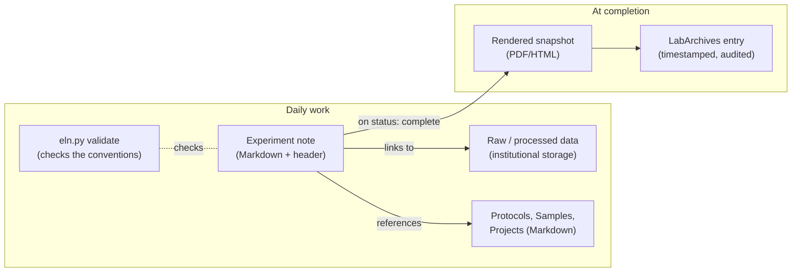

# Design notes: why this is shaped the way it is

This page gives the reasons for the design. To use the notebook, read
[`getting-started.md`](getting-started.md). Read this page before changing
how the system works.

## The decision this repo makes

Three other options were considered: adopting an ELN app or an editor
plugin as it comes, keeping LabArchives as the daily working tool, and
using folders with no conventions. This repository uses none of them. It
combines five parts:

- Jacob's model, in which the experiment is the unit of the record;
- plain Markdown files with a small header;
- a tool that creates the records and checks the naming;
- institutional storage for large data;
- LabArchives as the archival record.

## What Jacob's system already solved

In Jacob's system every experiment has, from the start: a unique ID, a
standard folder (`1-notes / 2-data_raw / 3-code / 4-data_processed /
5-figures`), raw data kept apart from processed data, stable IDs for
physical objects that are used again (gels, plasmids, oligos, slides), and
a short results summary that is written soon after the experiment and found
with one search (`JSRe0002_R` here; `JSRe0002-R` in his original). Deciding
what is recorded and where it goes is the hard part of an electronic
notebook. He did it with a spreadsheet and a folder-naming convention,
without software. See
[`reference/jacob-original-system/`](../reference/jacob-original-system/).

This repository does two things with that structure. It writes it as
Markdown notes with a header, and it checks it with a tool. The notes can
then be searched, can refer to each other by ID, and can be read by an AI.
The parts of Jacob's system that already work stay as they are.

## The conventions

Everything else depends on the header fields and the naming rules. Three
decisions follow from that:

- **The header is flat.** It is the `key: value` lines at the top of a
  note, with lists written as `key: [a, b]` and nothing nested (a small
  part of the YAML format). It can be read by `grep`, by ten lines of R or
  Python, by every YAML library, and by an AI model that has never seen the
  file before. A nested field would end that.
- **IDs are the links.** An ID written anywhere, such as `JSRe0002`, refers
  to that experiment. No link syntax, path, or editor feature is needed.
  Check looks up the IDs in the header fields and reports any that match no
  record.
- **The tool assigns IDs and checks the rules. The files do not depend on
  it.** `eln.py` is one Python file with no dependencies. If it were lost,
  the files would still be a complete, readable record, and
  [`CONVENTIONS.md`](CONVENTIONS.md) describes the rules well enough to
  write the tool again.

Check (`eln.py validate`) reports what does not follow the conventions. It
runs when you choose. An error is given for something that breaks the
system (a misnamed folder, a duplicate ID), and everything else is a
warning. It never stops you from writing.

## What was borrowed from the mature ELNs, and what was not

The institutional ELNs (eLabFTW, RSpace, SciNote, openBIS, Chemotion) and
the plain-text notebooks that came before this one were each examined for
what they do that a folder of Markdown files cannot. A practice was taken
over if it could be done with standard files, without tying the record to
one program, and without making daily use harder.

| practice | where it comes from | what this record does |
|---|---|---|
| Lock and timestamp an entry when it is finished | every institutional ELN; eLabFTW's "timestamp" | **Mark complete** writes a list of checksums in `sha256sum` format (a checksum is a number computed from a file's content, used to detect changes) and a dated snapshot (one HTML file with the whole experiment, for printing). `verify` shows later changes. The state is recorded and nothing is locked. |
| Export a finished entry as a document | eLabFTW/RSpace PDF export; mdlabbook's HTML and PDF | `render` and the snapshot: one HTML file with the images embedded, which prints to PDF from any browser. |
| Exchange records between ELN systems | [the `.eln` format](https://github.com/TheELNConsortium/TheELNFileFormat), a ZIP archive with a standard description of its contents (RO-Crate) that eLabFTW, RSpace, Kadi4Mat, PASTA, SampleDB, OpenSemanticLab, and SciLog import | `export --format eln`. Any of those systems can import the record, including the files and their checksums, so the lab is not tied to these tools. Checked with the reference RO-Crate library. |
| Templates per experiment type | eLabFTW experiment templates | `templates/experiment.{Type}.md`, optional. The header keys are the same; only the hints differ. |
| Link entries to items and resources | eLabFTW items, RSpace inventory, openBIS objects | The header fields `samples`, `protocols`, and `project`, which Check looks up. Which experiments used a sample is worked out from the notes and listed in the CSV files. |
| One root per project, dated and sortable, README in each directory | [Noble 2009](https://journals.plos.org/ploscompbiol/article?id=10.1371%2Fjournal.pcbi.1000424) | The five subfolders, `YYYYMMDD` in filenames, and the README each subfolder starts with. Jacob's system arrived at the same layout independently. |
| Fit the discipline; meet the technical requirements; plan the rollout | [Ten simple rules for implementing ELNs](https://journals.plos.org/ploscompbiol/article?id=10.1371%2Fjournal.pcbi.1012170) (Vandendorpe et al., 2024; three of its rules) | The templates and sample types are those of molecular biology. The requirements are a browser, or Python. The SOP and the sandbox are the rollout plan. |
| Keep tentative and confirmed claims apart so an AI does not conflate them | [Notes2Skills](https://arxiv.org/abs/2606.11897) (2026) | The hint under Interpretation asks for "Preliminary:" marks. The search skill and the ChatGPT briefing tell the AI to keep them. In the pilot (`sandbox/PILOT.md`) it kept them. |
| Dashboards over structured notes | Obsidian ELN's Dataview tables | The page's lists and filters, and the CSV files, which open in Excel. No plugin is needed. |

Left out: user accounts and permissions (the sync service and the
filesystem already have them), electronic signatures and audit trails
(they would need a server to mean anything), a database, and any feature
that would put part of the record somewhere other than the Markdown file.

## Two implementations, one behaviour

The tools exist twice: `scripts/eln.py` in Python and `docs/app/lib/` in
JavaScript. The Python one runs from a terminal or a launcher. The
JavaScript one runs in a browser on a folder the person picks, so nothing
has to be installed. It also runs in Node, where the MCP server uses it
(MCP is a way for AI programs to call tools). Both read and write the same
notebook folders, so they have to produce the same files.
`tests/test_js_parity.py` runs each operation through both and compares
the files, the Check messages, the index, the brief, the export, the
snapshot, and the list of checksums.

The JavaScript side is split so that later changes stay small. `lib/` has
the notebook logic with no browser or Node code in it. `store/` has one
file per place the files can live. `lib/tools.js` lists every operation
with a name and a description of its arguments. The page, the MCP server,
and the command line each call that list and add little of their own.
Another AI interface can be added later in the same way.

## Why flat files and not an app

The electronic notebooks the lab tried before were abandoned. They could
store the work, but entering it took too much effort. Plain files in
ordinary folders ask the least of the person: Finder or Explorer shows
them, any text editor writes the notes, and there is nothing to log into,
update, or migrate. An editor that displays Markdown well (VS Code, Typora,
Obsidian) shows the same files and is not required. This repository avoids
syntax that only one editor understands, so nobody is tied to one.

Flat files have two costs. Nothing stops a person from misnaming a folder,
and opening a `.md` file is a barrier for some people. The notebook page
and Check are there for these. On the page you fill in a form, the tool
names everything, and you can write the note there. Check tells you when
something is misnamed. The page keeps no records of its own: what it shows
is read from the files, and closing it changes nothing in the folder.

## Data lives outside the notebook

The record should contain Markdown, small tables, compressed
representative images, protocol copies, and analysis code. It should not
contain microscopy datasets, sequencing files, mass spec output, or
Illustrator and Prism source files duplicated across locations. Text and
code belong in files that people sync and compare. Large binary files
belong on storage the institution backs up, and the experiment note
records where they are (`raw_data_path`).

**Mark complete** writes a list of checksums for every file in the
experiment folder (`{ID}_MANIFEST.sha256`), and `eln.py verify` uses it to
show whether a file changed afterwards. The list does not say which raw
file produced which processed file or which figure. That record is what
would answer "what data supports this figure" later, and this repository
does not build it yet (Phase 4).

## The role of LabArchives

LabArchives is kept as the archive and is no longer where daily work is
written. It provides institutional authentication, controlled permissions,
audit trails, timestamps, and a defensible record. None of these is needed
while a note is being written, so its interface is not used for daily
notes. The intended flow:

1. Work is written in Markdown all week, without opening LabArchives.
2. When an experiment is `status: complete`, its note is rendered to
   PDF/HTML and deposited in LabArchives under the same experiment ID.
3. The LabArchives entry is a timestamped copy. The Markdown note stays the
   version that is edited.

Copies go one way only (Markdown → LabArchives, never back). Syncing in
both directions would leave it unclear which copy is authoritative. The
automatic bridge is not built yet, because it needs institutional API
access to be enabled first. Until then, print the snapshot that Mark
complete writes to PDF and upload it by hand. The vendored
`labarchive-integration` skill (`.agents/skills/vendor/`) already
documents the signed-request flow, the regional endpoints, and the split
between the ELN and Inventory APIs.

## Collaboration model: one folder per person, nothing central

A notebook is one folder per person. Each person keeps theirs where they
already keep their work: Dropbox, OneDrive, a lab share, or a drive. The
folder holds `notebook.md`, `Experiments/`, `Protocols/`, `Samples/`,
`Projects/`, and `Inventory/`. `notebook.md` says whose notebook it is
(`owner`, `initials`) and remembers the last ID given out for each kind of
record. There is no shared lab notebook, no server, no database, no git
repository, and no central list of people or notebooks. The only shared
component is the sync service or the lab share, which the lab already pays
for and already trusts with its files.

The tools are separate from the notebooks. The browser page works on
whichever folder is opened. The Python tools work on the folder named once
with `eln.py init --root`, or with `--root` on one command. With neither,
they work on the tools folder itself.

People who want to read each other's work keep their folders side by side
in a shared folder. When the shared folder is opened, the browser page
lists the notebooks in it, and **View a notebook (read-only)** opens any of
them without being able to change it. A note can cite a record in another
person's notebook by its ID. The initials in the ID say whose notebook it
is in, and Check does not report it as missing.

This is safe for these reasons:

- **IDs start with the owner's initials**, so two notebooks with different
  initials cannot give out the same ID, and there is no counter to share.
  Inside one notebook, the tools hold a lock while a record is created (an
  empty `.eln-lock` folder, there for a moment), so two programs working in
  it at once cannot give out the same number.
- **Every file is plain text or an ordinary data file**, so a sync conflict
  leaves two readable copies and cannot corrupt a database. Dropbox names
  the second one "conflicted copy"; OneDrive adds the computer name. Check
  lists both, and the fix is to read both and keep one.
- **The inventory is made from the notes**, so a conflicting copy of a CSV
  file can be deleted and the index made again.

This GitHub repository is where the tools are developed. The record is not
kept in it, and nobody in the lab needs it day to day. A `.git` folder
should never be inside a synced folder, because git and sync services
corrupt each other.

## AI integration, in stages

An AI is useful here because the header has enough structure to filter
notes before reading them, the sections are the same in every note so a
question can name one, and every claim can cite an experiment ID. The rule
in every stage is that the AI finds and cites what the notes say, and
people draw the conclusions.

1. **Assistants that cite the notes** (built).
   `AGENTS.md` gives any coding agent (Codex, Claude Code, Cowork, Gemini
   CLI) the lab's rules when it is opened in the tools folder; it works on
   the notebook named with `init --root`. `.agents/skills/lab/` teaches the
   three recurring tasks: record an experiment, search and cite, and
   summarize a project. `eln.py export` plus `docs/ai-briefing.md` do the
   same for ChatGPT by copy and paste. The MCP server offers the
   notebook's operations to AI programs that support it. None of this
   needs an API key; it runs on subscriptions the lab has. Pinned
   methodology skills from K-Dense add guidance on design, statistics,
   writing, and citation; see [`ai-agents.md`](ai-agents.md).
2. **Lab-wide search.** `eln.py find` and the CSV index filter by every
   header field and by free text today. An index that searches by meaning
   is worth adding only when keyword search starts missing things. Look
   again at a few hundred notes.
3. **Automated project synthesis.** The `eln-project-synthesis` skill
   drafts *Current state*, and a person reviews it before it is saved.
   Running it on a schedule (nightly, per project) can be added once the
   pilot has notes.
4. **Instrument/data ingestion.** Scripts that watch a drop folder, compute
   checksums, name files by experiment ID, and record which file came
   from which. Start with Western blots or microscopy.

The stages are in this order because an AI cannot repair inconsistent IDs
or missing header fields, and it repeats the errors it reads. The
conventions and Check therefore came first.

## What this repo builds now vs. later

**Now (Phase 1):** the conventions; the templates; `scripts/eln.py`
(create, adopt an older folder, validate, index, find, report, export as
one Markdown file, as a folder of plain files, or as `.eln`, complete,
verify, render); `notebook.md` in each notebook; the browser page
(`docs/app/`), which needs nothing installed in Chrome or Edge and can open
a notebook view-only; the launcher page (`scripts/eln_web.py`) for Safari
and Firefox; the double-click launchers; the MCP server; two fictional
sandbox notebooks to practice on; the agent instruction files and fifteen
vendored skills; tests on three operating systems. With these, nobody
needs a terminal or a Markdown editor, and a pilot can run.

**Later:** *Phase 2* is the lab-wide rollout with the SOP, once the
problems found in the pilot are fixed. *Phase 3* is the LabArchives bridge
(needs institutional API access). *Phase 4* is ingestion and the record of
which file came from which, and a search-by-meaning index if the notebooks
outgrow `find`.

## Non-negotiables vs. flexible choices

**Required:** experiment ID, project, researcher, date, objective, raw-data
location, protocol, results, interpretation, status; files named with the
ID; raw data untouched.

**Flexible:** daily-note style, prose or bullets, how many images, which
editor, which analysis tool (R, Python, Prism, or another), personal task
management.

The system fixes how experiments are named, laid out, and described. How a
person thinks and writes is left to them.
