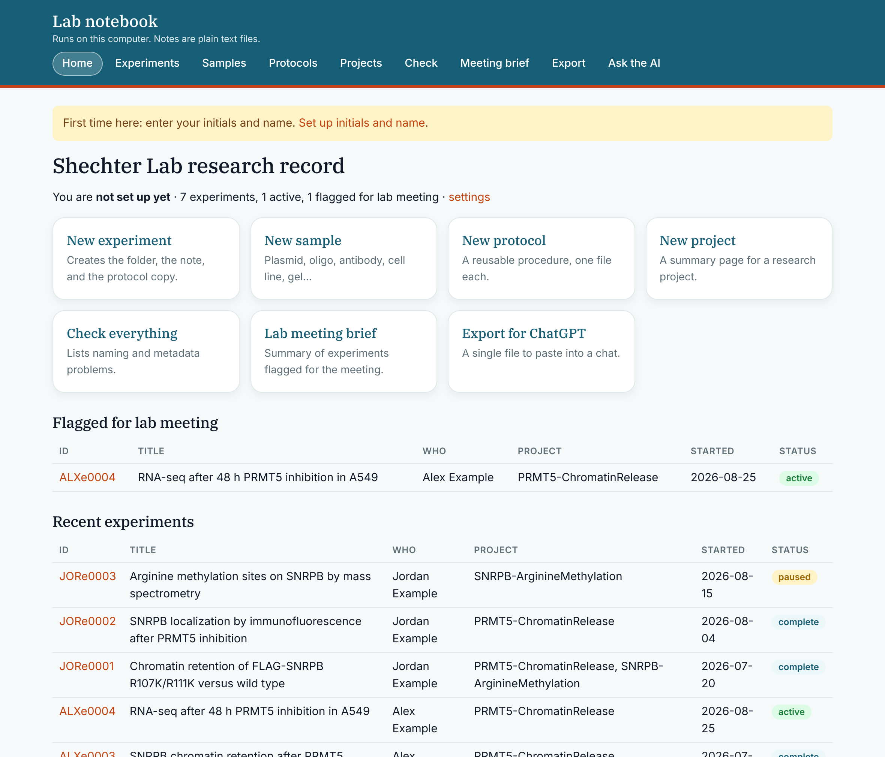
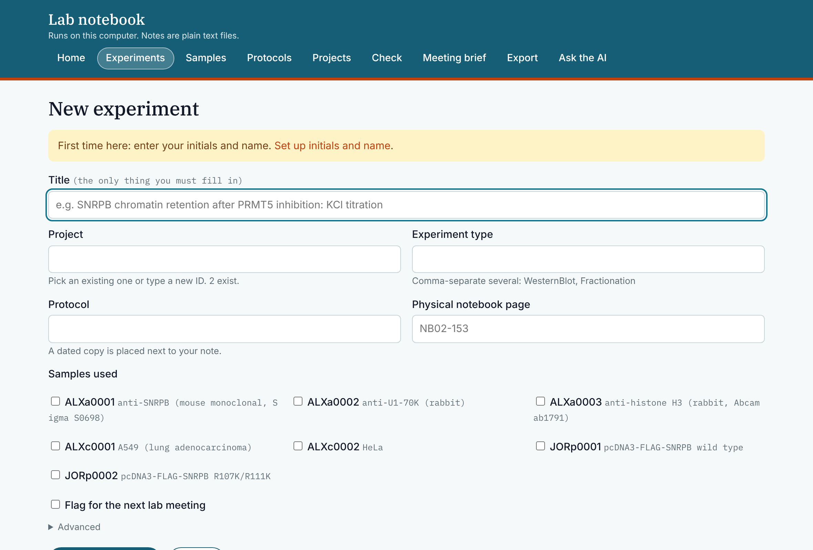
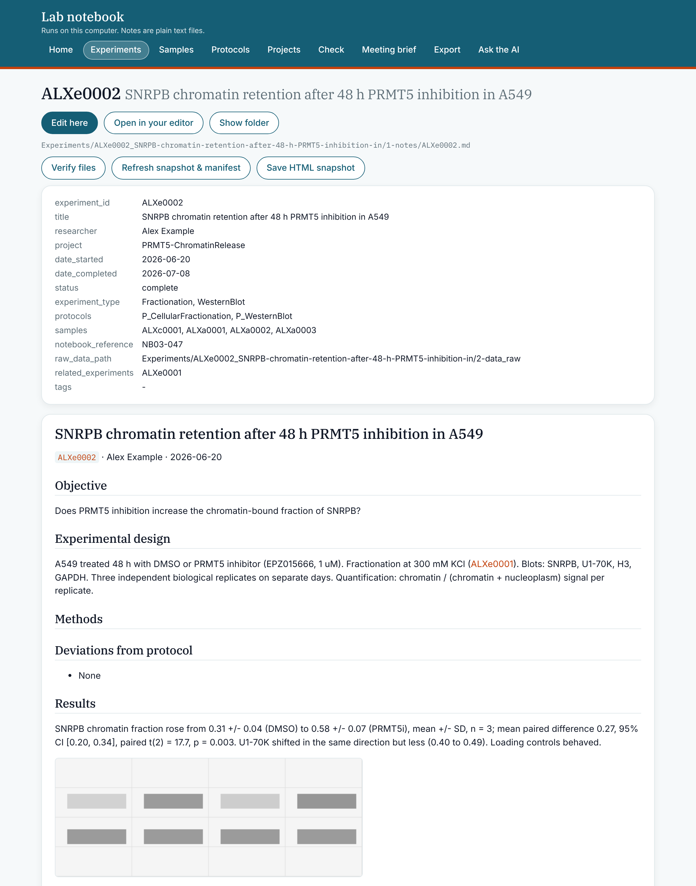

# Getting started

Setup is done once per computer. After that, you create an experiment by
double-clicking a launcher and filling in a form.

## 0. Where the record lives

The record is one folder: these tools plus `Experiments/`, `Protocols/`,
`Samples/`, `Projects/`. It lives in the lab's Dropbox or OneDrive. There
is no server, account, or central copy. The synced folder is the record,
and the files in it are plain text.

**If someone has already set it up:** make sure the lab's folder is synced
to your computer (it will be in your Dropbox or OneDrive), and go to §1.

**If you are setting it up for the lab** (once, by whoever runs the lab):

1. Download this folder from GitHub: green **Code** button → **Download
   ZIP**, unzip. If you used `git clone` instead, delete the hidden `.git`
   folder inside it; git and sync services corrupt each other.
2. Rename the folder if you like (`ShechterLab-ELN`) and move it into the
   lab's shared Dropbox or OneDrive.
3. Double-click `launchers/Open ELN` once to see the page come up. The
   record starts empty. `sandbox/`, `tests/`, and `.github/` are not needed
   for daily use and can be deleted. `reference/` holds Jacob's original materials.

After that, do not move or rename things inside the folder by hand. Use
the page or the launchers.

## 1. One-time setup for your computer

**Mac.** Python is already there. The first time you double-click a
launcher, macOS will say it's from an unidentified developer: right-click
(or Control-click) the launcher, choose **Open**, then **Open** again
(on the newest macOS: *System Settings → Privacy & Security → Open
Anyway*). Only needed once per launcher, and not at all if the folder came
by OneDrive sync or `git clone`. If a window offers to install *command
line developer tools*, click **Install**; that is Python being set up and
takes a few minutes.

**Windows.** Install Python once from <https://www.python.org/downloads/>
and tick **Add python.exe to PATH** on the first screen of the installer.
The launchers then work by double-click.

**Linux.** Python 3 is already there; run `python3 scripts/eln_web.py`.

## 2. Open the page

Double-click **`launchers/Open ELN`**. A small window appears and your
browser opens a page like this:



The page runs on your own computer (the address starts with `127.0.0.1`);
and does not upload anything. Keep the small window open; closing it stops
the page. The first time, it asks for your initials and name under
**settings**. Your initials become your ID prefix (`JSRe0001`, `JSRe0002`,
…), so two people cannot get the same ID.

To practice without touching the lab's record, double-click
**`launchers/Try the Sandbox`**. It opens the same page on fictional data
that can be reset.

## 3. Create your first experiment

Click **New experiment**. Only the title is required. The other
fields can be added later.



Click **Create experiment**. You now have a folder with the five standard
subfolders, a note with the header filled in, a copy of the protocol as it
stood today, and a row in the inventory. The page shows the new note.

## 4. Write in the note

Click **Edit here** on the note's page, write under the section titles,
and click **Save**. The note is a plain text file, so you can also edit it
in any text editor: **Open in your editor** opens it in whatever your
computer uses for `.md` files.



Keep the `##` section titles so that every experiment has the same
structure. Write freely under them. Fill in **Objective**
before you start; **Results**, **Interpretation**, and **Decision** when
you have them. Leave a section as "None" rather than deleting it.

## 5. Put files where they belong, named with the ID

**Show folder** on the note's page opens the experiment folder.

```
2-data_raw/         instrument output. Original filenames. Never edit, never rename.
3-code/             JSRe0001_analysis.R
4-data_processed/   JSRe0001_quantification.csv
5-figures/          JSRe0001_R_fractionation-KCl_20260904.png   <- the results figure (R = "results")
```

Start every file you make with the experiment ID; join words with hyphens.
This makes every file findable by searching for the experiment ID. Each subfolder has a short README saying what
goes in it. Full grammar: [`CONVENTIONS.md`](CONVENTIONS.md) §3.

If the raw data is too large to keep here (microscopy, sequencing), leave
it on the institutional storage and put its location in the note's
`raw_data_path` line. A figure you put in `5-figures/` and link from the
Results section shows up on the note's page.

## 6. The rest of the page

| Button | What it does |
|---|---|
| **New sample** | A record for a plasmid, oligo, antibody, cell line, mouse line, peptide, protein prep, slide, or gel. Gets an ID like `JSRp0001`. Tick it in the experiment form from then on. |
| **New protocol** | One file per protocol, e.g. `Protocols/P_WesternBlot.md`. Edit it in place as it improves; bump the `version` date and add a Change log line. |
| **New project** | A summary of a research project. Conclusions cite experiment IDs. |
| **Check** | Reads every note and folder and lists what breaks the conventions. `ERROR` = fix it; `WARN` = advice. |
| **Meeting brief** | The lab-meeting document from everything tagged `meeting`, plus the active-experiments table. One click saves it as a file. |
| **Export** | Bundles a project (or all active experiments) into one file to paste into ChatGPT. See [`ai-agents.md`](ai-agents.md). |
| **Experiments / Samples / Protocols / Projects** | Browse and filter. Every ID on every page is a link. |
| **Ask the AI** | Example questions for an AI assistant, and which of the two methods (pasting an export into ChatGPT, or an agent opened in the folder) each one works with. |

## 7. When an experiment is finished

Click **Mark complete** on the note's page. It checks that Results and
Interpretation are written (and says so if not), sets the status and date,
and writes two files next to the note: a one-file HTML snapshot of the
whole experiment (figures included; print it to PDF for LabArchives) and a
checksum list of every file in the folder, so **Verify files** can later
show whether anything changed. The note is not locked. If you edit the
experiment later, click **Refresh snapshot & manifest**.

## 8. Command line

Every launcher and every button runs the same script:

```bash
python3 scripts/eln.py init                                # initials, name, where files live
python3 scripts/eln.py new experiment --title "..."         # add --project, --protocol, --samples, --tags meeting ...
python3 scripts/eln.py new experiment --interactive         # asks questions instead
python3 scripts/eln.py new sample --type plasmid --title "..."
python3 scripts/eln.py validate                            # --strict makes warnings fail too
python3 scripts/eln.py find --status active --project PRMT5-ChromatinRelease
python3 scripts/eln.py report
python3 scripts/eln.py export --project PRMT5-ChromatinRelease --out brief.md
python3 scripts/eln_web.py                                 # the page, by hand
```

The terminal-window launchers (`New Experiment`, `Check Everything`, and
so on) run the same commands and prompt for the values.

## 9. Keeping the notes somewhere other than the tools (unusual)

Normally the notes sit next to the tools in the synced folder and no
configuration is needed. If the lab keeps notes somewhere else (a server
mount, a different shared folder), tell the tool once:

```bash
python3 scripts/eln.py init --root "/path/to/ShechterLab/ELN"
```

That writes `~/.ai_eln.json`; the page, the launchers, and every command
use it from then on. `AI_ELN_ROOT` in the environment or `--root` on a
command overrides it for one shell or one call.

## If something doesn't work

- **Mac: "cannot be opened because it is from an unidentified developer"**:
  right-click → Open (once per launcher), or Privacy & Security → Open Anyway.
- **Mac: double-clicking opens the file in a text editor instead of running
  it**: the executable bit was lost in a download or sync. In Terminal:
  `chmod +x` followed by a space, then drag the `launchers` folder into the
  window, add `/*.command`, press Enter. Or run
  `python3 scripts/eln_web.py` directly.
- **Windows: a window flashes and closes, or "python is not recognized"**:
  install Python (§1) with *Add to PATH* ticked, then try again.
- **The page says "First time here"**: click *settings* and enter your
  initials and name.
- **"could not open a port"**: another copy of the page is already
  running; find its window, or close it and try again.
- **Check says a folder "does not match {ID}_{slug}"**: someone made or
  renamed an experiment folder by hand. Rename it to
  `{ID}_{words-with-hyphens}` or recreate it with New experiment.
